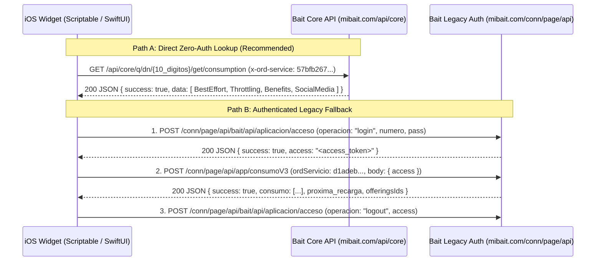
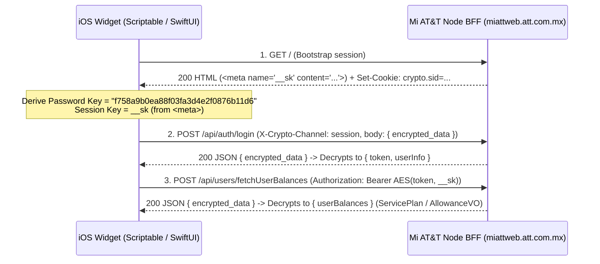
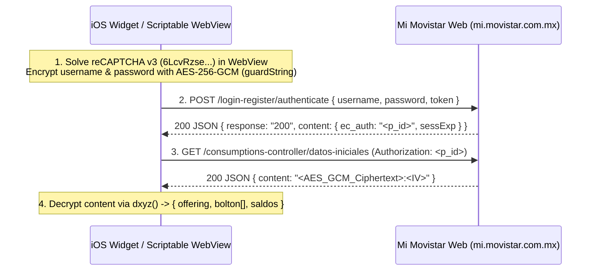

<!-- Copiado de amaynez/telcel-widget-agy ("Mexican Carriers Widget API.md"). Referencia de las APIs de Bait y otras compañías. -->

# Research Report: iOS Data Widget APIs for Bait, AT&T México, and Movistar México (2026)

This report documents the reverse-engineered web architectures, authentication flows, cryptographic layers, REST endpoints, and JSON schemas required to replicate the **Mi Telcel iOS Widget** ([`Telcel Widget API.md`](Telcel%20Widget%20API.md)) for Mexico's other three major mobile providers: **Bait (Walmart / Altán Redes)**, **AT&T México**, and **Movistar México**.

All endpoints, headers, cryptographic keys, and payload schemas below were verified directly against each carrier's live production JavaScript bundles in October 2026.

---

## Executive Comparison Matrix

| Feature / Constraint | **Telcel** (Baseline) | **Bait** (`mibait.com`) | **AT&T México** (`miattweb.att.com.mx`) | **Movistar México** (`mi.movistar.com.mx`) |
| :--- | :--- | :--- | :--- | :--- |
| **Widget Feasibility** | **9/10** (Working) | **10/10 (Easiest)** | **6/10 (Medium)** | **3/10 Headless / 7/10 WebView** |
| **Auth Mechanism** | 4-step SSO + Basic + Bearer (`token:b2f`) | **Zero-Auth GET by MSISDN** *(or Legacy Password / Walmart SSO)* | Custom AES-encrypted `POST /api/auth/login` + Bearer token | AES-256-GCM `POST /login-register/authenticate` + **reCAPTCHA v3** |
| **Payload Encryption** | Base64 password (`pB64`) | Plain JSON | **CryptoJS AES-256-CBC** (`__sk` session key + static password key) | **WebCrypto AES-256-GCM** (static `guardString` + 12-byte IV) |
| **WAF / Bot Defense** | Standard | Cloudflare + Akamai (permissive with header) | **F5 Distributed Cloud (`volt-adc`)** + `crypto.sid` cookie | **Cloudflare (`__cf_bm`)** + **Google reCAPTCHA v3** |
| **Session Lock Risk** | High (requires `/sso/revoke`) | None on `GET /consumption`; `/aplicacion/acceso` has logout | Low (stateless JWT wrapped in session AES) | Medium (short-lived `p_id` / `sessExp`) |
| **Data Units Returned** | `KB`, `MB`, `GB` (Wave B2F blocks) | `MB` (`resume.total`, `resume.unused`) | `KBytes`, `MBytes`, `GB` (`Quota`, `RemainingQuota`, `UtilizedQuota`) | Pre-formatted strings (`"Llevas X GB de Y GB"`) + `%` |

---

## 1. Bait (Walmart / Altán Redes — `mibait.com`)

> [!TIP]
> **Key Discovery:** Bait's production Angular SPA (`main.8834299eaa09db08.js` and `199.d124b282cff25015.js`) queries line consumption via an Ordenaris/Altán proxy endpoint (`GET /api/core/q/dn/{10_digitos}/get/consumption`) that **only checks a static `x-ord-service` API key header**—no user password, OTP, or Bearer token is required to fetch real-time data consumption for a 10-digit Bait number.

### 1.1 Architecture & Static Keys (`module 5312`)

Bait's self-service portal (`https://mibait.com`) is built by **Ordenaris** on top of **Altán Redes** and **Walmart SSO**. The production bundle embeds the following static service keys:

| Key Name | Header Name | Production Value | Purpose |
| :--- | :--- | :--- | :--- |
| `xOrdService` | `x-ord-service` | `57bfb26735aa4ec3a1baafa864006d7d` | Direct MSISDN consumption & profile status queries (`/api/core/q/dn/...`) |
| `ordenarisKey` / `serviceKey` | `ordServicio` | `d1adeb1327644c339671f7bc9f3e0789` | Legacy consumption V3 (`/conn/page/api/app/consumoV3`) & user verification |
| `formKey` / `accessForm` | `ordForm` | `05729fc9308c11eea85000155d0a1e12` | Profile verification (`/api/core/servicio/perfil/bait`) |
| `ssoServiceKey` | `ordServicio` | `5e44a42c99464e66a04e89c3dcbfbff9` | OTP generation & validation (`/api/core/sso/otp/...`) |
| `xOrdServiceSSO` | `x-ord-service` | `fcda5170897a4393b744e40c1b4b9a6d` | Walmart SSO bridge (`/api/v1/sso/...`) |
| `xOrdApiSSO` | `x-ord-api` | `26716189c88044d2a083784bf02ffded` | Walmart SSO bridge (`/api/v1/sso/...`) |
| `xOrdHostSSO` | `x-ord-host` | `https://mibait.com` | Walmart SSO bridge (`/api/v1/sso/...`) |
| `sso.client_id` | Query param | `9d085bd0-1c84-4e08-9624-6aaa71640621` | Walmart OAuth2 (`https://www.walmart.com.mx/sso/`) |

> [!NOTE]
> **Public Key Scope, Privacy & Rate Limits:** `x-ord-service` (`57bfb26735aa4ec3a1baafa864006d7d`) is a public client-side key shipped in `mibait.com`'s frontend bundle and scoped strictly to read-only MSISDN consumption (`/get/consumption`) and line status (`/get/status`) lookups. Responses return only aggregate MB totals and expiration timestamps—never subscriber PII (name, email, billing, or payment details require authenticated Path B/C tokens). Requests are gated upstream by Cloudflare/Akamai WAF per-IP rate limits, so clients must cache responses locally and poll only on standard widget refresh intervals.



---

### 1.2 Path A: Direct Zero-Login Consumption Query (1 Step)

Used directly by Bait's `/home` dashboard component (`199.d124b282cff25015.js` -> `getComsuption(dn)`).

- **Method & URL:**
  `GET https://mibait.com/api/core/q/dn/{10_digitos}/get/consumption`
- **Headers:**
  ```http
  Accept: application/json
  x-ord-service: 57bfb26735aa4ec3a1baafa864006d7d
  ```
- **cURL Probe Example:**
  ```bash
  curl -s "https://mibait.com/api/core/q/dn/5512345678/get/consumption" \
    -H "Accept: application/json" \
    -H "x-ord-service: 57bfb26735aa4ec3a1baafa864006d7d"
  ```

#### JSON Response Schema & Widget Aggregation Logic (`module 4768`, `cv`)

```json
{
  "success": true,
  "data": [
    {
      "category": "Data",
      "type": "BestEffort",
      "tethering": true,
      "unlimited": false,
      "resume": {
        "total": 10240,
        "unused": 6144,
        "expire_date": "2026-11-15T23:59:59.000Z"
      }
    },
    {
      "category": "Data",
      "type": "Throttling",
      "tethering": false,
      "unlimited": false,
      "resume": {
        "total": 10240,
        "unused": 10240,
        "expire_date": "2026-11-15T23:59:59.000Z"
      }
    },
    {
      "category": "Data",
      "type": "Benefits",
      "offers_detail": [
        {
          "total": 5120,
          "unused": 5120,
          "effective_date": "2026-10-15T00:00:00.000Z",
          "expire_date": "2026-11-15T23:59:59.000Z"
        }
      ]
    },
    {
      "category": "Data",
      "type": "SocialMedia",
      "unlimited": true,
      "resume": {
        "total": 5120,
        "unused": 4800,
        "expire_date": "2026-11-15T23:59:59.000Z"
      }
    }
  ]
}
```

- **Units:** All `total` and `unused` values are in **MB** (`1024 MB = 1 GB`).
- **Base + Reduced-Speed Data (`BestEffort` + `Throttling`):**
  - Filter `data` where `item.type === "BestEffort" || item.type === "Throttling"`.
  - $\text{Total Base MB} = \sum \text{item.resume.total}$
  - $\text{Used Base MB} = \sum (\text{item.resume.total} - \text{item.resume.unused})$
  - $\text{Available Base MB} = \sum \text{item.resume.unused}$
- **Promotional / Bonus Data (`Benefits`):**
  - Filter `data` where `item.type === "Benefits"`, flatten `offers_detail[]`, and keep offers where `new Date(offer.expire_date) > now`:
  - $\text{Total Promo MB} = \sum \text{offer.total}$, $\text{Available Promo MB} = \sum \text{offer.unused}$.
- **Cutoff / Expiration Date (`nextRecharge`):**
  - Take the maximum `resume.expire_date` across all items with `category` in `["Data", "Minutes", "Message"]`.
- **Optional Line Status Check:**
  - `GET https://mibait.com/api/core/q/dn/{10_digitos}/get/status?profile=mbb` with headers `x-ord-service: 57bfb26735aa4ec3a1baafa864006d7d` and `extra: sub-profile`.

---

### 1.3 Path B: Legacy Password Login & `consumoV3` (Fallback)

If Bait restricts unauthenticated `GET /api/core/q/dn/...` in the future:

1. **Login (`POST https://mibait.com/conn/page/api/bait/api/aplicacion/acceso`):**
   - **Body:**
     ```json
     {
       "operacion": "login",
       "numero": "<10_digitos>",
       "pass": "<password>"
     }
     ```
     *(Use `"operacion": "login_hbb"` for Internet en Casa, or endpoint `/conn/page/api/app/accesoMifi` for MiFi).*
   - **Response:** `{"success": true, "access": "<access_token>", "numero": "55...", "nombre": "...", "email": "..."}`
2. **Fetch Balance (`POST https://mibait.com/conn/page/api/app/consumoV3`):**
   - **Header:** `ordServicio: d1adeb1327644c339671f7bc9f3e0789`
   - **Body:** `{"access": "<access_token>"}`
   - **Response (`module 4768`, `QM`):**
     - `consumo[]`: Array of buckets where `nombre` is one of:
       - `"datosVelocidadNormal"` (Base High-Speed Data)
       - `"datosVelocidadReducida"` (Throttled / Fair-Use Data)
       - `"datosUsoInternacional"` (Roaming Data)
       - `"datosRedesSociales"` (Social Media Data)
       - `"minutos"` / `"sms"`
       - Each item contains `mb_totales`, `mb_usados`, `mb_disponibles`.
     - `proxima_recarga`: Expiration date string.
     - `comparteDatos`: Boolean (tethering enabled).
     - `esIlimitado`: Boolean.
     - `offeringsIds[]`: `[{ "offeringId": "...", "expireDate": "..." }]`.
3. **Logout (`POST https://mibait.com/conn/page/api/bait/api/aplicacion/acceso`):**
   - **Body:** `{"operacion": "logout", "access": "<access_token>"}`

---

### 1.4 Path C: Walmart SSO Flow (`consumoSSO`)

For accounts migrated to Walmart Unified SSO:
1. `POST https://mibait.com/api/v1/sso/redirect/url?operation=login&validate=true` with headers `x-ord-service: fcda5170897a4393b744e40c1b4b9a6d`, `x-ord-host: https://mibait.com`, `x-ord-api: 26716189c88044d2a083784bf02ffded` and body `{"dn": "<10_digitos>"}`.
2. Authenticate on `https://www.walmart.com.mx/sso/verify-password?...` to obtain OAuth `code`.
3. Exchange `code` at `POST https://mibait.com/api/v1/sso/token/get?decrypt=true` (`{"code": "<code_value>"}`) -> returns `access_token`.
4. Query `POST https://mibait.com/conn/page/api/sso/consumoSSO` with `Authorization: Bearer <access_token>` and body `{"numero": "<10_digitos>"}`.
5. Revoke session at `POST https://mibait.com/api/v1/sso/session/logout`.

---

## 2. AT&T México (`miattweb.att.com.mx`)

> [!IMPORTANT]
> **Key Discovery:** AT&T México's web portal (`https://miattweb.att.com.mx`) uses a Node.js BFF that **does not require CAPTCHA on standard password login**, making headless widget refreshes possible. While the initial bootstrap `GET /` returns plaintext HTML containing the `<meta name="__sk">` value alongside an `HttpOnly` session cookie (`crypto.sid`), **every subsequent API request and response payload is AES-encrypted** using `CryptoJS.AES` with that dynamic `__sk` session key.

### 2.1 Architecture & Dual-Layer AES Encryption (`module 8577` & `gt`)



AT&T México's Angular SPA (`main.ed09d11c356e0378a7b7.js`) applies **two distinct `CryptoJS.AES` keys** (OpenSSL `Salted__` EVP_BytesToKey MD5 key-derivation + AES-256-CBC with PKCS#7 padding):

1. **Static Password Key (`getPasswordKey()` in `module 8577`):**
   - De-obfuscated from `o = { mi: ["6780f2","e4d3af1","930f88","ae0b9a","857f"], l1: "91", l2: "6d11b" }`:
   - Reversing `o.mi.join("")`, splitting on `"91"`, and appending reversed `o.l2` produces the static passphrase:
     ```text
     f758a9b0ea88f03fa3d4e2f0876b11d6
     ```
   - Used by `encPass(password)` to encrypt `encrypted_password` in `/api/auth/login` and `enc_entered_otp` in `/api/util/validateATTMEXOTP`.

2. **Session Payload Key (`getApiKey()` in `module 8577`):**
   - On `GET https://miattweb.att.com.mx/`, the server sets `Set-Cookie: crypto.sid=...; Path=/; HttpOnly; Secure; SameSite=Strict` and renders two `<meta>` tags at the end of `<head>`:
     ```html
     <meta name="__kf" content="334dcbed"><meta name="__sk" content="3a3349dae2b56a533a32c604">
     ```
   - When `ENABLE_SESSION_CRYPTO` is active (`true` in production), `getApiKey()` returns the 24-character hex string in `<meta name="__sk">`, and the HTTP interceptor (`gt`) adds the header:
     ```http
     X-Crypto-Channel: session
     ```
   - *Fallback static key (`mixApiKey("__kf")`):* If `__sk` is absent, `mixApiKey("334dcbed")` evaluates to `"b5a0bab52d0227b35b1334dcbed7b1d"`.
   - Every outgoing JSON body `obj` is sent as:
     ```json
     { "encrypted_data": "<CryptoJS.AES.encrypt(JSON.stringify(obj), __sk).toString()>" }
     ```
   - Every incoming response body `{"encrypted_data": "..."}` is decrypted via:
     ```javascript
     JSON.parse(CryptoJS.AES.decrypt(res.encrypted_data, __sk).toString(CryptoJS.enc.Utf8))
     ```

---

### 2.2 Step-by-Step Endpoint Specification

#### Step 1: Bootstrap Session & Extract `__sk`
- **Method & URL:** `GET https://miattweb.att.com.mx/`
- **Capture from Response:**
  1. Cookies: `crypto.sid`, `BIGipServerpool_miattweb`, `TS01dc4fc6`.
  2. Regex match `<meta name="__sk" content="([^"]+)">` -> `SESSION_KEY`.
  3. Generate client `subscriber_id`: `(Date.now().toString(36) + Math.random().toString(36).substring(4)).toUpperCase()`.

#### Step 2: Authenticate (`POST /api/auth/login`)
- **Method & URL:** `POST https://miattweb.att.com.mx/api/auth/login`
- **Headers:**
  ```http
  Content-Type: application/json
  Accept: application/json
  X-Crypto-Channel: session
  subscriber_id: <GENERATED_SUBSCRIBER_ID>
  Cookie: crypto.sid=<SESSION_COOKIE>
  ```
- **Plaintext Payload (before encrypting with `SESSION_KEY`):**
  ```json
  {
    "msisdn": "<10_digitos>",
    "encrypted_password": "<CryptoJS.AES.encrypt(password, 'f758a9b0ea88f03fa3d4e2f0876b11d6')>",
    "migrationAccepted": false
  }
  ```
- **Decrypted Response (`200 OK`):**
  ```json
  {
    "stausCode": 200,
    "statusMessage": "LOGIN_SUCCESS",
    "token": "<RAW_JWT_TOKEN>",
    "userInfo": {
      "subscriber_type": "postpaid",
      "enterprise_user": false
    }
  }
  ```
- **Important Token Wrapping Rule (`module 4761`, `setLoginStatus`):**
  - The Angular SPA does **not** send `<RAW_JWT_TOKEN>` directly in the `Authorization` header! It encrypts `token` with `encryptObj(token)` (`CryptoJS.AES.encrypt(JSON.stringify(token), SESSION_KEY).toString()`) and sends:
    ```http
    Authorization: Bearer <AES_ENCRYPTED_TOKEN>
    ```

#### Step 3: Query Data Balances, Promo Bags, and Cutoff Date (`POST /api/users/fetchUserBalances`)
- **Method & URL:** `POST https://miattweb.att.com.mx/api/users/fetchUserBalances`
- **Headers:**
  ```http
  Content-Type: application/json
  Authorization: Bearer <AES_ENCRYPTED_TOKEN>
  X-Crypto-Channel: session
  subscriber_id: <GENERATED_SUBSCRIBER_ID>
  Cookie: crypto.sid=<SESSION_COOKIE>
  ```
- **Plaintext Payload (before encrypting with `SESSION_KEY`):**
  - **For Postpaid / Hybrid / Fenix (and Amdocs Prepaid):**
    ```json
    {
      "subscriber_type": "postpaid",
      "balance_type": null
    }
    ```
  - **For Legacy Prepaid:** Call twice with `balance_type: 2` (Cash Balance) and `balance_type: 1` (Data & Social Allowances), plus `POST /api/users/getPrepaidGeneralInfo` (`{}`) for the plan name.

#### Step 4: Parsing the Decrypted Balance Response (`module 8613`, `userService`)

##### A. Postpaid / Hybrid / Ármalo Schema (`userBalances[0].ServicePlan`)
```json
{
  "userBalances": [
    {
      "ServicePlan": {
        "ProductRatePlanName": "AT&T Ármalo 11 GB",
        "ProductRatePlanID": "283945505",
        "ProductOfferID": "283945505",
        "paymentAmount": "599.00",
        "paymentDueDate": "2026-11-05T00:00:00",
        "remainDuePaymentDays": "16",
        "remainCutOffDays": "9",
        "prepaidBalanceAmount": "0.00",
        "prepaidEndDate": null,
        "allowances": [
          {
            "AllowanceID": "283945505",
            "AllowanceName": "Internet incluidos",
            "AllowanceDescription": "Datos del plan",
            "FriendlyName": "Datos del plan",
            "UnitType": "KBytes",
            "Quota": "11534336",
            "RemainingQuota": "6291456",
            "UtilizedQuota": "5242880",
            "Unlimited": "N",
            "EndTime": "2026-10-28T23:59:59"
          },
          {
            "AllowanceID": "99001234",
            "AllowanceName": "Bono Promocional",
            "AllowanceDescription": "Datos Promocionales",
            "FriendlyName": "Bono de datos",
            "UnitType": "MBytes",
            "Quota": "3072",
            "RemainingQuota": "3072",
            "UtilizedQuota": "0",
            "Unlimited": "N",
            "EndTime": "2026-10-28T23:59:59"
          }
        ]
      }
    }
  ]
}
```
- **Aggregation Rules (`processUserBalancesForHTML`):**
  - Filter `allowances[]` where `new Date(EndTime) > now` and `UnitType.toLowerCase()` is `"kbytes"` or `"mbytes"`.
  - Exclude social media (`AllowanceDescription.toLowerCase().includes("redes")`) and streaming (`includes("reaming")`) from the main data sum.
  - When `Unlimited === "N"` and `tempdataInGB < 99990`:
    - Convert `Quota` (Total), `RemainingQuota` (Available), and `UtilizedQuota` (Used) to MB/GB according to `UnitType` (`KBytes / 1024 = MB`, `MBytes = MB`).
    - Sum across all matching allowances (`individualInternetBundles` + `additionalServices`).
  - **Days Remaining:** `ServicePlan.remainCutOffDays` (`validityPlan`).
  - **Cutoff Date:** `EndTime` of the allowance where `AllowanceID == ProductRatePlanID`.

##### B. Prepaid Schema (`userBalances.MTX_SS_GetBalanceOutVO.BalanceVO.AllowanceVO[]`)
- Each item in `AllowanceVO[]` provides:
  - `FriendlyName`: Bag name
  - `AllowanceOfferType`: `"base"` (Plan Base) vs add-on/promo
  - `UnitType`, `Quota`, `RemainingQuota`, `UtilizedQuota`, `Unlimited`, `EndTime`.

#### Complementary AT&T Endpoints

| Endpoint | Method | Plaintext Body | Purpose |
| :--- | :--- | :--- | :--- |
| `/api/users/getPrepaidGeneralInfo` | `POST` | `{}` | Returns `MTX_SS_GeneralInformationOutVO.GeneralInformationVO.ProductOfferName` |
| `/api/att/users/fetchFenixBalances` | `POST` | `{}` | Balance lookup for AT&T Fenix platform lines |
| `/api/invoice/invoice-balance` | `POST` | `{}` | Postpaid invoice balance & payment status |
| `/api/invoice/service-plan` | `POST` | `{}` | Contracted plan details |
| `/api/att/consume/{subscriberType}` | `POST` | `{"unitType": 3, "initialDate": "...", "finalDate": "..."}` | Detailed daily data consumption (`unitType: 3` = Data) |
| `/api/auth/logoutWithMigration` | `POST` | `{"msisdn": "<10_digitos>"}` | Session logout |

---

## 3. Movistar México (`mi.movistar.com.mx`)

> [!WARNING]
> **Key Discovery:** Movistar México's web portal (`https://mi.movistar.com.mx`) is the hardest to automate in a pure headless widget because `POST /login-register/authenticate` enforces **Google reCAPTCHA v3** (`sitekey: 6LcvRzseAAAAAAv639uV9uh6vRHRBSi0Jk_fsaRf`) behind **Cloudflare** (`__cf_bm`). However, once a session token (`p_id` / `ec_auth`) is obtained (e.g., via an interactive Scriptable `WebView` login), consumption queries are simple `GET` requests decrypted with a static AES-256-GCM key (`guardString`).

### 3.1 Architecture & AES-256-GCM Encryption (`compile/guard_util.js`)



In `https://mi.movistar.com.mx/compile/guard_util.js` and `index.html`:
- **Static Key (`guardString`):**
  ```javascript
  const guardString = "MDM4MTg5NTQwNzIyNjEyNjc5MzM5MjE0NTMwMjgwNjg=";
  // Base64 decodes to the 32-byte raw ASCII key:
  // "03818954072261267933921453028068"
  ```
- **Encryption (`cxyz(plaintext)`):**
  - Generates a 12-byte random IV (`Uint8Array(12)`).
  - Encrypts UTF-8 `plaintext` using `AES-GCM` (`tagLength: 128`) with the 32-byte raw key.
  - Formats output as URL-safe Base64 (`+` -> `-`, `/` -> `_`):
    ```text
    <base64url(ciphertext_with_16B_tag)>:<base64url(12B_iv)>
    ```
- **Decryption (`dxyz(ciphertext)`):**
  - Splits by `:` into `[encryptedBase64Url, ivBase64Url]`, restores standard Base64 padding, and decrypts via `AES-GCM` (`tagLength: 128`) using `guardString`.

---

### 3.2 Step-by-Step Endpoint Specification

#### Step 1: Authenticate (`POST /login-register/authenticate`)
- **Method & URL:** `POST https://mi.movistar.com.mx/login-register/authenticate`
- **Headers:**
  ```http
  Content-Type: application/json
  X-Forwarded-For: <CLIENT_PUBLIC_IP>
  ```
- **Body (`js/login-registration/login-ecare.js`):**
  ```json
  {
    "username": "<cxyz(10_digit_phone)>",
    "password": "<cxyz(password)>",
    "token": "<google_recaptcha_v3_token_for_action_login>"
  }
  ```
  *(reCAPTCHA v3 site key: `6LcvRzseAAAAAAv639uV9uh6vRHRBSi0Jk_fsaRf`, action: `'login'`).*
- **Response (`200 OK`):**
  ```json
  {
    "response": "200",
    "content": {
      "ec_auth": "<P_ID_SESSION_TOKEN>",
      "sessExp": "2026-10-20T04:36:22.000Z",
      "redirect": "/consumptions",
      "userImage": "..."
    }
  }
  ```

#### Step 2: Query Data Consumption & Validity (`GET /consumptions-controller/datos-iniciales`)
- **Method & URL:** `GET https://mi.movistar.com.mx/consumptions-controller/datos-iniciales`
- **Headers (`js/consumptions/consumptions.js`):**
  ```http
  Authorization: <P_ID_SESSION_TOKEN>
  Content-Type: application/json
  ```
  *(Note: `Authorization` takes the raw `p_id` / `ec_auth` value directly, **without** the `Bearer` prefix).*
- **Encrypted Response:**
  ```json
  {
    "content": "<base64url_aes_gcm_payload>:<base64url_iv>"
  }
  ```
- **Decrypted JSON Schema (`dxyz(result.content)`):**
  ```json
  {
    "offering": "Movistar Libre",
    "userType": 2,
    "bolton": [
      {
        "name": "Navegación",
        "vigencia": "28/10/2026",
        "consumption": 65,
        "consumptionLabel": "Llevas 6.50 GB de 10.00 GB",
        "totalBenefit": "10.00 GB"
      },
      {
        "name": "Redes Sociales",
        "vigencia": "28/10/2026",
        "consumption": 0,
        "consumptionLabel": "Ilimitado",
        "totalBenefit": "Ilimitado"
      },
      {
        "name": "Minutos",
        "totalBenefit": "Ilimitado"
      }
    ],
    "saldos": {
      "totalBalance": "0.00",
      "giftBalance": "0.00",
      "topupsBalanceExpiration": "28/10/2026",
      "topupsBalanceExpirationDate": 1793145600000,
      "topupsBalanceCurrentDate": 1792469182000
    }
  }
  ```
- **Parsing Rules (`js/consumptions/consumptions.js`):**
  - **Plan Name:** `responseParams.offering`
  - **Primary Data Bag (`bolton[0]`):**
    - **Cutoff / Validity Date:** `bolton[0].vigencia`
    - **Used Percentage:** `bolton[0].consumption` (`%`)
    - **Used & Total Data:** Extracted from `bolton[0].consumptionLabel` (e.g., `"Llevas 6.50 GB de 10.00 GB"`: `.replace("Llevas ", "").split(" de ")` -> `used = "6.50 GB"`, `total = "10.00 GB"`).
  - **Social Media / Minutes / SMS:** Iterate over `bolton[]` matching `i.name === "Redes Sociales"` or `i.name === "Minutos"`.

#### Step 3: Complementary Movistar Endpoints (All use `Authorization: <p_id>`)

| Endpoint | Method | Encrypted? | Purpose |
| :--- | :--- | :--- | :--- |
| `/consumptions-controller/detail-profile` | `GET` | Plain JSON strings | Returns `content.profileDetail` (`planIncluye[]`, `servAdicionales[]`) & `profileDerivativeType` |
| `/billing-controller/datos-iniciales` | `GET` | `dxyz(data.content)` | Returns postpaid `billings[]` (`amount`, `dueDate`, `dueDateSpa`, `billCycleEndTime`, `status`) |
| `/consumptions-controller/historial-llamadas` | `GET` | Plain JSON | Call history CDRs |
| `/consumptions-controller/historial-mensajes` | `GET` | Plain JSON | SMS history CDRs |

---

## 4. Implementation Recommendations for This Repo

1. **Bait (`mibait.com`) — Immediate Drop-In Support:**
   - Can be added to Scriptable or `WidgetKit` in **~30 lines of code** using `GET https://mibait.com/api/core/q/dn/{10_digitos}/get/consumption` with `x-ord-service: 57bfb26735aa4ec3a1baafa864006d7d`.
   - Requires only the user's 10-digit phone number (no password needed unless falling back to `/conn/page/api/app/consumoV3`).
2. **AT&T México (`miattweb.att.com.mx`) — Pure Scriptable / Swift Implementation with AES Helper:**
   - Implement a 25-line OpenSSL `Salted__` EVP_BytesToKey + AES-256-CBC helper (`CommonCrypto` in Swift, or WebCrypto/pure-JS in Scriptable).
   - Flow: `GET /` (grab `crypto.sid` + `__sk`) $\rightarrow$ `POST /api/auth/login` $\rightarrow$ `POST /api/users/fetchUserBalances`.
3. **Movistar México (`mi.movistar.com.mx`) — Interactive WebView Login + Cached `p_id`:**
   - Because of Google reCAPTCHA v3 on `/login-register/authenticate`, when running in-app (`config.runsInApp` in Scriptable), open a `WebView` to `https://mi.movistar.com.mx/login`, let the user log in once, capture the session value (`p_id`) from `content.ec_auth` in the `/login-register/authenticate` response, cache `p_id` in `Keychain`, and use `GET /consumptions-controller/datos-iniciales` + WebCrypto AES-GCM decryption with the static `guardString` key until `sessExp`.
